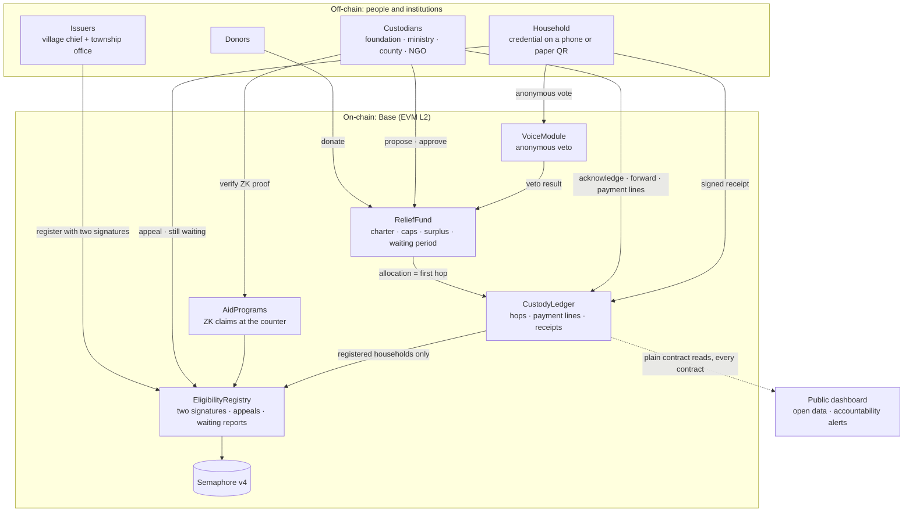
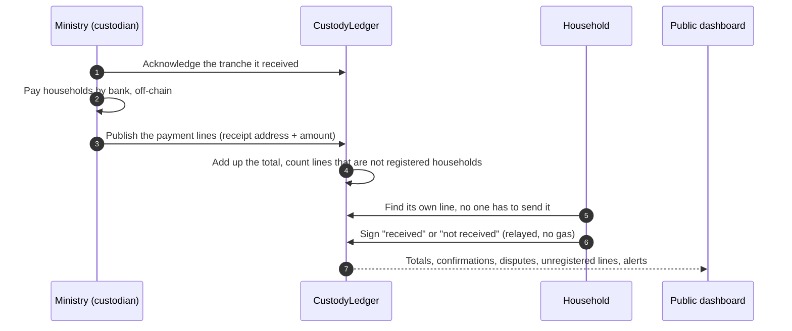

<div align="center">


# Kept

**Disaster-relief promises you can verify.**<br/>
Other systems prove aid was sent. Kept lets the people it was sent to say whether it arrived.

[](https://kept-lilac.vercel.app)
[](contracts/deployments/84532.json)
[](https://semaphore.pse.dev)
[](#run-it-locally)
[](#license)

[Problem](#the-problem) · [Solution](#the-solution) · [How it works](#how-it-works) · [Architecture](#architecture) · [Why Web3](#why-web3) · [Feasibility](#feasibility) · [Run it](#run-it-locally) · [Limitations](#known-limitations)

<sub>Built for the <i>Web3 for Social Good Hackathon 2026</i> (SMU · GSR Foundation · University of Málaga) · Tech Track</sub>

</div>

---

> [!NOTE]
> The demo fund, households and decisions are **simulated**. The [Guangfu, real data](https://kept-lilac.vercel.app/replay) page is not: it replays the relief foundation's published disclosure. Place names follow Guangfu Township, Hualien (Taiwan), where a barrier lake overflowed on 2025-09-23.

## The problem

A disaster fund makes two promises: **to donors**, about how the money will be used; **to affected households**, that no one will be left out. Both are hard to check, and the same loop repeats across countries: money is raised before a plan exists, the custodian keeps every record, the people affected have no say, money sits unspent or arrives late, and trust moves elsewhere.

| Where | What happened | Source |
|---|---|---|
| **Haiti, 2010** | US$488M raised; six permanent homes built. | [ProPublica/NPR](https://www.propublica.org/article/how-the-red-cross-raised-half-a-billion-dollars-for-haiti-and-built-6-homes) |
| **Valencia, 2024** | The regional audit office found the recording of DANA flood donations *"inadecuado"*; all €22.1M received in 2024 was still unbudgeted at year-end. | [El Español](https://www.elespanol.com/valencia/20260106/sindicatura-cuentas-ve-inadecuado-registro-donaciones-dana-millones-no-gestionaron/1003744078508_0.html) |
| **Hualien, 2024** | A county donation account of ~NT$790M still held ~NT$420M a year later; its committee had no affected households on it. Donations reaching the county that year were under a fifth of 2018's. | [PTS](https://news.pts.org.tw/article/744652), [PTS](https://news.pts.org.tw/article/695533) |
| **Guangfu, 2025** | Of NT$1.21bn paid out by the relief foundation, **98.8% was pre-allocated** and **4% was reconciled** a year later. After the first hand the public sees aggregate totals only, and **no household can confirm its own payment**. | [Foundation disclosure](https://www.tf4dr.org/fundraising_plans/156/credits/534) |
| **Guangfu, 2025** | Three villages outside the "red zone" were left off the first aid list and had to protest. | [CNA](https://www.cna.com.tw/news/aloc/202510060164.aspx) |

Every group involved has said so in public: an affected household that found out *"only after a year"* that NT$400M was unspent; an NGO whose roster was *"finally confirmed at the end of November"*, ten weeks after the flood; an indigenous representative who got *"no meeting notice or call"* for seven months. The sources are on the app's [Why Kept](https://kept-lilac.vercel.app/why) page.

## The solution

Kept starts where the public trail stops: **after the first hand**. Each custodian acknowledges what it receives and publishes every payment batch as pseudonymous lines, a receipt address and an amount and never a name. Each household finds its own line without asking anyone and signs *"received"* or *"not received"*. The custodian gets reconciliation evidence as it happens; the public sees past the first hand; households can say *"this never reached me"*.

| | Today | With Kept |
|---|---|---|
| Visible past the first hand | Aggregate totals | **Every hand, down to pseudonymous payment lines** |
| Household can confirm or dispute its payment | No channel | **Signed "received" / "not received"** |
| Custodian can pad the roster or confirm for itself | Undetectable | **Lines that are not registered households are counted publicly; only households can sign** |
| Excluded households | Visible through protest | **Public appeals and anonymous "still waiting" counts per village** |
| Say over how the money is used | Attend if invited; no vote | **Anonymous veto, one vote per household** |
| Fund purposes and surplus | Can be decided later | **Fixed at fundraising; changes wait in public** |
| NGO needs the roster to check eligibility | Yes | **No: a zero-knowledge proof at the counter** |

## How it works

- **Custody.** Each tranche is recorded by the sender and acknowledged by the receiver. Payment batches are published as lines; the contract adds them up itself and counts any line whose receipt address is not a household registered with two signatures. Only that household, or a social worker designated for its village, can sign for its line, and the household's own answer always wins. `CustodyLedger`
- **Eligibility.** A household is verified only after two signatures: the village chief and the township office. Registration rides on the door-to-door visits the government already makes after a disaster. Getting paid never requires anything from the household; confirming is optional. NGOs check eligibility on the spot with a zero-knowledge proof and never receive the roster. `EligibilityRegistry` `AidPrograms`
- **Voice.** The same credential gives each household one anonymous vote on changes (Semaphore), a public appeal when it is left out, and a weekly anonymous *"still waiting"* report that does not depend on any custodian recording anything. `VoiceModule`
- **Commitment.** Purposes, caps and the surplus purpose are fixed when money is raised. Cap changes, extensions and uses of the surplus wait through a public period and go ahead unless households veto them; after a veto the same kind of change is blocked for four waiting periods. Emergencies may only move cap between purposes and are reviewed afterwards. `ReliefFund` `KeptFactory`
- **Accountability alerts.** Published rules over the public record flag where to look: unacknowledged tranches, money held for months, unregistered lines, disputes, slow appeals, households waiting while the township reports nothing.

**Never on-chain:** names, ID numbers, bank accounts. Payment rosters appear only as pseudonymous lines; a household's confirmation would reveal the same line anyway. Eligibility is still decided by people; Kept makes their decisions attributable.

> [!IMPORTANT]
> In phase 1, while donations stay in bank accounts, the contracts bind the **public record**, not the bank account: nothing outside the charter can be recorded as an allocation, and the record cannot be rewritten, but an off-record bank payment is still possible. Kept makes it harder to hide, not impossible.

## Architecture





Every fund is a clone of one audited template, so a custodian cannot deploy a look-alike without the commitments. Households never pay gas: a relayer submits their signatures and proofs. Borrowed, not reinvented: Semaphore v4 (PSE), OpenZeppelin; prior art includes WFP Building Blocks, Spanish Red Cross RedChain and *Not Yet Another Digital ID* (EPFL × ICRC).

## Why Web3

| Requirement | Why a database is not enough |
|---|---|
| The people being overseen should not keep the only ledger | Each custodian keeps its own records and decides what to publish. |
| Several independent custodians share one record | The foundation, ministries, county and NGOs answer to different authorities; none is a natural operator for the others. |
| Households need anonymous standing | In small communities a named "no" carries social cost; zero-knowledge proofs give "a verified household, one vote, not saying which". |
| Rules that act before, not after | Taiwan's donation-law reform has stalled since 2020; Kept can implement the county ordinance nearly 300 people petitioned for. |

## Feasibility

0. **No permission needed:** civil-society volunteers can already turn a custodian's published disclosure into open data and alerts, as the [real-data page](https://kept-lilac.vercel.app/replay) does for Guangfu.
1. **Under current law:** money stays in banks; custodians join voluntarily and get a verifiable record that helps them win back donors.
2. **By ordinance or amendment:** government donation accounts are required to use the format.
3. **With regulated NT$ stablecoins** (Taiwan's Virtual Asset Service Act passed in June 2026): funds sit in the contract and the charter is enforced on the money itself.

**Cost, measured** with the real zero-knowledge verifier at Guangfu's scale (4,039 households, 48 transfers, one published line, one confirmation and one NGO claim per household, two votes at 25% turnout): about **4.9 billion gas**, roughly **US$150–1,500** at assumed L2 prices, at most **0.003%** of the money raised. Open source (MIT) as a digital public good, complementary to civic platforms such as [guangfu.tw](https://guangfu.tw).

## Run it locally

Requirements: Node 20+, [Foundry](https://getfoundry.sh).

```bash
cd contracts && npm install
forge test                 # 69 unit tests
anvil                      # in a separate terminal
npm run deploy:local       # Poseidon, Semaphore and Kept on the local chain
npm run e2e                # optional: 14 end-to-end checks with real Semaphore proofs

cd ../web && npm install
npm run dev                # http://localhost:3000, then Setup → Set up scenario
```

The dashboard has a 7-step guided demo. Institutional keys are held by the demo server and a relayer pays gas for households; in production each institution signs with its own wallet.

<details>
<summary><b>Run against Base Sepolia · deployed contracts</b></summary>

Create `kept/.env` (gitignored):

```
DEMO_PRIVATE_KEY=0x…        # a key used only for this testnet demo; other demo roles are derived from it
NEXT_PUBLIC_CHAIN_ID=84532
NEXT_PUBLIC_RPC_URL=https://base-sepolia-rpc.publicnode.com
SEMAPHORE_ADDRESS=0x8A1fd199516489B0Fb7153EB5f075cDAC83c693D
DEMO_TIMELOCK_SECONDS=300
```

```bash
cd contracts && npm run deploy:base-sepolia   # writes deployments/84532.json
cd ../web && npm run dev:testnet              # http://localhost:3001
```

Current addresses are in [`contracts/deployments/84532.json`](contracts/deployments/84532.json).

</details>

## Known limitations

- **No field validation yet.** The evidence of need comes from public statements, official records and the foundation's real data, not from interviews or a pilot.
- **Phase 1 cannot stop off-record bank payments;** it raises the cost of hiding them.
- **Pseudonymous, not anonymous.** Each payment line shows a receipt address and an amount, and registrations show village and damage tier, so small villages can be partly inferred by anyone reading the chain. The dashboard hides counts under 5; moving the village off-chain is planned.
- **Majority veto can work against a minority,** for example the few households that need temporary housing. Emergencies keep a path for urgent moves (reviewed afterwards); tier-weighted voting is a possible next step.
- **Votes are anonymous but not receipt-free;** [MACI](https://maci.pse.dev) is the planned upgrade. Votes are veto-only and need a turnout quorum.
- **The registry authority is one key in the demo;** in production it should be a multisig of independent bodies, since the ministry is also a custodian.
- **An issuer could still register ghost households;** two signatures and public issuer statistics make it attributable, not impossible.

## License

[MIT](https://opensource.org/license/mit). Research notes, fact-checks and the full design discussion (Traditional Chinese) are in [`docs/`](docs/README.md).
