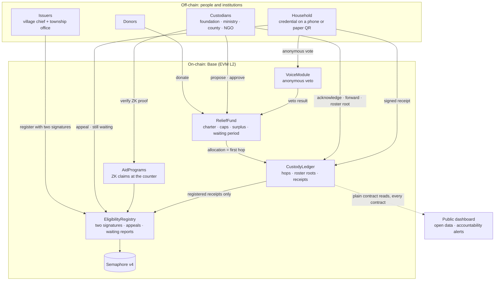
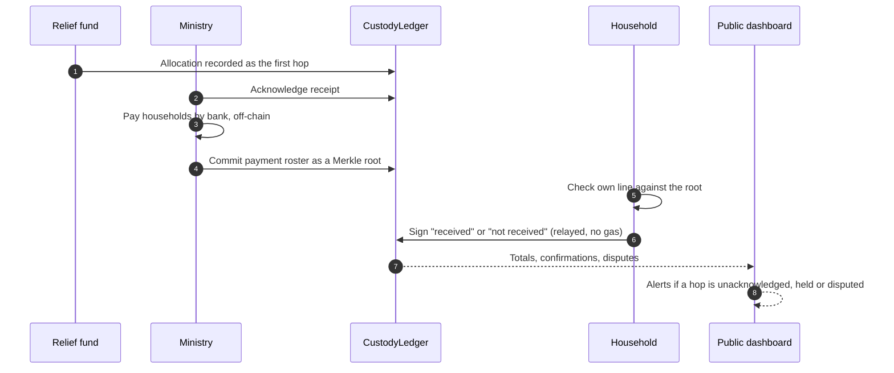

<div align="center">


# Kept

**Disaster-relief promises you can verify.**<br/>
Follows donated money past the first hand, and gives the people it is for a voice.

[](https://kept-lilac.vercel.app)
[](contracts/deployments/84532.json)
[](https://semaphore.pse.dev)
[](#run-it-locally)
[](#license)

[Problem](#the-problem) · [Real data](#real-data-guangfu-2025) · [Solution](#the-solution) · [Architecture](#architecture) · [Why Web3](#why-web3) · [Feasibility](#feasibility) · [Run it](#run-it-locally) · [Demo](#demo-walkthrough) · [Limitations](#known-limitations)

<sub>Built for the <i>Web3 for Social Good Hackathon 2026</i> (SMU · GSR Foundation · University of Málaga) · Tech Track</sub>

</div>

---

> [!NOTE]
> All households, amounts and decisions in the demo are **simulated**, except the *Guangfu, real data* page, which uses the relief foundation's published, institution-level disclosure. Place names follow Guangfu Township, Hualien (Taiwan), where the Mataian River barrier lake overflowed on 2025-09-23.

## The problem

A disaster fund makes two promises: **to donors**, about how the money will be used; **to affected households**, that no one will be left out. Both are hard to check, and the same loop repeats across countries:

> Money is raised before a plan exists → the custodian keeps every record → the people affected have no say → money sits unspent or arrives late → trust moves elsewhere.

| Where | What happened | Source |
|---|---|---|
| **Haiti, 2010** | US$488M raised; six permanent homes built. | [ProPublica/NPR](https://www.propublica.org/article/how-the-red-cross-raised-half-a-billion-dollars-for-haiti-and-built-6-homes) |
| **Hualien, 2024** | A county donation account of ~NT$790M still held ~NT$420M a year later; its committee met three times, with no affected households on it. | [PTS](https://news.pts.org.tw/article/744652) |
| **Hualien, 2024** | After disputes over the 2018 donations, the county had received NT$453M through the relief foundation by May, under a fifth of the NT$2.7bn it received in 2018; a councillor said people *"would rather give to the central government"*. | [PTS](https://news.pts.org.tw/article/695533) |
| **Guangfu, 2025** | Of NT$1.21bn paid out by the relief foundation, 98.8% was pre-allocated, and NT$49M (4%) had been reconciled a year later. Pre-allocating is normal in an emergency; **after the first hand, nothing is visible**. | [Foundation disclosure](https://www.tf4dr.org/fundraising_plans/156/credits/534) |
| **Guangfu, 2025** | Three villages outside the "red zone" were left off the first aid list and had to protest. | [CNA](https://www.cna.com.tw/news/aloc/202510060164.aspx) |
| **Governance** | Affected households have no vote on how the money is used: the foundation's board has no seat for them, and Hualien's rules let at most five attend committee meetings, speaking only with the chair's permission. | [County rules](https://glrs.hl.gov.tw/glrsout/LawContent.aspx?id=GL001170) |

### Evidence of need, in stakeholders' own words

We have not yet interviewed practitioners (see [Validation](#validation)). Every group Kept serves has, however, already described the problem in public:

| Who | What is on the record | Source | Kept answers with |
|---|---|---|---|
| Affected household | *"Only after a year did we find out nearly NT$400M of the donations was still left."* | [PTS, 2025-03-31](https://news.pts.org.tw/article/744652) | Public commitments and progress |
| Affected household | A ground-floor household living alone missed aid several times because agencies used different criteria. | [SETN, 2025-12-18](https://www.setn.com/news/1767342) | Public appeals; anonymous "still waiting" reports |
| Affected household | A temporary-housing application was refused over a decades-old property record and took two weeks to correct. | [The Reporter, 2026-02-12](https://www.twreporter.org/a/the-year-of-healing-hualien-mataian-villagers) | Attributable decisions and a public appeal trail |
| Indigenous representative | Appointed to a reconstruction committee, then received *"no meeting notice or call"* for seven months. | [Newsmarket, 2026-09-21](https://www.newsmarket.com.tw/blog/242854/) | A household voice that does not depend on being invited |
| NGO | *"With the township office's help, the household roster was finally confirmed at the end of November"*; aid was handed out about ten weeks after the disaster. | [CCRA final report](https://www.ccra.org.tw/pdf/report/0923%20%20final%20project%20report_20260107.pdf) | Eligibility checks without handing the roster to each NGO |
| Custodian | Pre-allocations are checked against each agency's relief roster later; a year on, 4% is reconciled. | [Foundation disclosure](https://www.tf4dr.org/fundraising_plans/156/credits/534) | Roster roots and household receipts as reconciliation evidence |
| Donors | Donations reaching the county in 2024 were under a fifth of 2018's. | [PTS, 2024-05-17](https://news.pts.org.tw/article/695533) | A fund custodians can prove they kept |
| Citizens | Nearly 300 people petitioned for a county ordinance to oversee disaster donations. | [PTS, 2024-05-17](https://news.pts.org.tw/article/695533) | A technical implementation of such an ordinance |
| Oversight bodies | The Control Yuan corrected the county over 2018 quake procurement; the Legislative Budget Center found the national guideline on disaster donations not binding. | [Control Yuan](https://www.cy.gov.tw/News_Content.aspx?n=124&sms=8912&s=16366) · [Budget Center](https://www.ly.gov.tw/Pages/Detail.aspx?nodeid=45805&pid=223464) | Records that do not depend on the custodian's own reporting |

## Real data: Guangfu 2025

The app's **[Guangfu, real data](https://kept-lilac.vercel.app/replay)** page replays the relief foundation's 11th public disclosure. Its 48 transfers were transcribed by hand from the published images and add up exactly to the stated NT$1,209,049,669.

| | |
|---|---|
| Raised | **NT$1,397,723,978** (≈US$44M) |
| Paid out | **NT$1,209,049,669** in 48 transfers |
| Pre-allocated, to be reconciled later | **98.8%** of what was paid out (21 transfers) |
| Received by one ministry | **93%** |
| Reconciled a year after the disaster | **4.1%** |
| Household estimate in the foundation's own records | moved from **1,837** to **4,039** |

## The solution

**Kept starts where the trail stops: reconciliation.** Every custodian acknowledges what it receives, commits each payment roster as a Merkle root, and lets each household confirm or dispute its own line. The custodian gets reconciliation evidence it now assembles by hand; the public can see past the first hand; households can say *"this never reached me"*. Commitments and household voice build on that record.

### Today vs. with Kept

| | Today | With Kept |
|---|---|---|
| Visible past the first hand | No | **Every hand, until the household** |
| Household can confirm or dispute its payment | No channel | **Signed "received" / "not received"** |
| Custodian can confirm its own payments | — | **No: only registered households count** |
| Excluded households | Visible only through protest | **Public appeals and "still waiting" counts per village** |
| Affected households' say | Attend if invited; no vote | **Anonymous veto, one vote per household** |
| Fund purposes and surplus | Can be decided later | **Fixed at fundraising; changes wait in public** |
| NGO needs the roster to check eligibility | Yes | **No: zero-knowledge proof at the counter** |
| Personal data on-chain | — | **None: only commitments, hashes and Merkle roots** |
| Machine-readable data | PNG / JPG / PDF | **Open JSON, readable by anyone** |

### What Kept does

| Mechanism | What it guarantees | Contracts |
|---|---|---|
| **Custody** | Each tranche is recorded by the sender and acknowledged by the receiver. Payment rosters are committed as **Merkle roots**: the public sees totals, each household proves it is counted and **signs** "received" or "not received". Only receipt addresses registered with two signatures count, so a custodian cannot pad a roster with its own keys. Proxies (e.g. a social worker for elders) are designated per village, and a household's own answer always replaces a proxy's. | `CustodyLedger` |
| **Eligibility** | A household is verified only after **two signatures** (village chief + township office). NGOs check eligibility on the spot with a zero-knowledge proof, **without receiving any roster**; per-programme nullifiers block double claims and prevent linking claims across programmes. | `EligibilityRegistry` `AidPrograms` |
| **Voice** | The same credential gives each household **one anonymous vote** on changes, a public **appeal** when it is left out, and a weekly anonymous **"still waiting"** report, which does not depend on any custodian recording anything. | `VoiceModule` `EligibilityRegistry` |
| **Commitment** | Purposes, caps and the surplus purpose are fixed when money is raised. Cap changes, extensions and uses of the surplus wait through a public period and go ahead unless households veto them. After the deadline, money can only go to the surplus purpose. Emergencies need a stricter threshold, may only move cap between purposes, and are reviewed afterwards: a veto returns the unspent part and revokes the emergency path. | `ReliefFund` `KeptFactory` |
| **Accountability alerts** | Published rules over the public record flag where to look: unacknowledged tranches (14 days), money held (90 days), disputes, heavy proxy use, slow appeals, households waiting while the township reports nothing. | Dashboard |

> [!IMPORTANT]
> **What "enforced" means, phase by phase.** For money held by the contract (the demo's token, later a regulated NT$ stablecoin), the charter is enforced: an allocation outside it reverts. In phase 1, while donations stay in bank accounts, the contract binds the **public record**: nothing outside the charter can be recorded as an allocation, and the record cannot be rewritten. It cannot stop off-record bank payments; Kept makes them harder to hide, not impossible.

## Architecture



Every fund is a clone of one audited template (`KeptFactory`), so a custodian cannot deploy a look-alike without the commitments. Households never pay gas: a relayer submits their signatures and proofs. Rosters and personal data stay with the township office.

### Reconciliation, step by step



**Never on-chain:** names, ID numbers, bank accounts, rosters. Eligibility is still decided by people; Kept makes their decisions attributable.

**Borrowed, not reinvented:** [Semaphore v4](https://semaphore.pse.dev) (PSE), OpenZeppelin, Merkle trees. Prior art we build on: WFP Building Blocks (cross-agency deduplication), Spanish Red Cross RedChain (ZK eligibility), *Not Yet Another Digital ID* (EPFL × ICRC, IEEE S&P 2023).

## Why Web3

| Requirement | Why a database is not enough |
|---|---|
| The people being overseen should not keep the only ledger | Each custodian keeps its own records and decides what to publish; a shared, append-only record that no single custodian controls is the point. |
| Several independent custodians share one record | The foundation, ministries, county and NGOs answer to different authorities; none is a natural operator for the others. |
| Households need anonymous standing | In small communities a named "no" carries social cost; zero-knowledge proofs give "a verified household, one vote, not saying which". |
| Rules that act before, not after | Law acts after the fact, and Taiwan's donation-law reform has stalled since 2020. Kept can implement the county ordinance nearly 300 people petitioned for. |

**Deliberately off-chain:** personal data, rosters and bank payments.

## Feasibility

**Path to adoption**

1. **Phase 1, under current law.** Money stays in banks; custodians join voluntarily and get a verifiable record that helps them win back donors.
2. **Phase 2.** A county ordinance or legal amendment requires the format for government donation accounts.
3. **Phase 3.** Once regulated NT$ stablecoins exist (Taiwan's Virtual Asset Service Act passed in June 2026), funds sit in the contract and the charter is enforced on the money itself.

**Cost at Guangfu's scale, measured.** Gas per operation was measured with the real zero-knowledge verifier: about **4.7 billion gas** for the whole disaster (4,039 households, 48 transfers, one confirmation and one NGO claim per household, two votes at 25% turnout), roughly **US$140–1,400** at assumed L2 prices, **at most 0.003%** of the money raised. Details on the [real-data page](https://kept-lilac.vercel.app/replay).

**Complementary, not competing.** [guangfu.tw](https://guangfu.tw) coordinates recovery information; Kept supplies verifiable payment and eligibility data such a platform can display. Open source (MIT), designed as a digital public good.

## Tech stack

| Layer | Choice |
|---|---|
| Contracts | Solidity 0.8.28, Foundry, OpenZeppelin |
| Zero-knowledge | Semaphore v4 (Groth16), proofs generated in the browser |
| Chain | Base Sepolia (EVM L2); any EVM chain works |
| App | Next.js 15, React 19, Tailwind 4, viem |
| Hosting | Vercel |

<details>
<summary><b>Deployed contracts (Base Sepolia, chain 84532)</b></summary>

| Contract | Address |
|---|---|
| KeptFactory | `0x433256da41BB19bD111843f0AEA63FCdd01e7702` |
| EligibilityRegistry | `0x85C52d03A3606Df24B1ca1321e6494AC329aC9e1` |
| CustodyLedger | `0xD97508E6b9DBbB809B0Bb5F138FDB0908490f0b7` |
| VoiceModule | `0x482741b3A7074f53EC79c49581936D39ae0B9293` |
| AidPrograms | `0x12D40B048fC83f34AB1652498806A3C3b5F403Bf` |
| MockTWD (demo token) | `0xf5c85DED35B7AD9Af669b824891F8f7CDc05608a` |
| Semaphore v4 (official) | `0x8A1fd199516489B0Fb7153EB5f075cDAC83c693D` |

</details>

## Repository

```
contracts/   Foundry project: 6 contracts (+ a mock NT$ token), unit tests, deploy scripts,
             end-to-end script with real Semaphore proofs
web/         Next.js app: public dashboard, real-data page, and a screen for each role
docs/        Research notes, fact-check, project definition, submission drafts (Traditional Chinese / English)
```

## Run it locally

Requirements: Node 20+, [Foundry](https://getfoundry.sh).

```bash
# 1. contracts
cd contracts
npm install
forge test                 # 64 unit tests
anvil                      # in a separate terminal
npm run deploy:local       # deploys Poseidon, Semaphore and Kept to the local chain
npm run e2e                # optional: 13 end-to-end checks with real Semaphore proofs

# 2. web app
cd ../web
npm install
npm run dev                # http://localhost:3000
```

Then open **Setup → Set up scenario** to create the simulated disaster, fund, 20 households, appeals and a partly delivered custody chain.

<details>
<summary><b>Run against Base Sepolia</b></summary>

Create `kept/.env` (gitignored):

```
DEMO_PRIVATE_KEY=0x…        # a key used only for this testnet demo; other demo roles are derived from it
NEXT_PUBLIC_CHAIN_ID=84532
NEXT_PUBLIC_RPC_URL=https://base-sepolia-rpc.publicnode.com
SEMAPHORE_ADDRESS=0x8A1fd199516489B0Fb7153EB5f075cDAC83c693D
DEMO_TIMELOCK_SECONDS=300
```

```bash
cd contracts && npm run deploy:base-sepolia   # writes deployments/84532.json
cd ../web && npm run dev:testnet              # http://localhost:3001, then Setup → Set up scenario
```

</details>

## Demo walkthrough

The order follows the story: what the public sees today, then reconciliation, then the promises.

1. **Guangfu, real data**: the foundation's real disclosure; the trail stops after the first hand.
2. **Public dashboard**: the simulated fund. *Accountability alerts* already flag a disputed payment and villages where verified households say they are still waiting.
3. **Household**: create a credential; press *Simulate: chief scans this code*.
4. **Village & township**: as the Nanfu chief, propose the registration; as the township office, approve it (two signatures).
5. **Custodians**: as the ministry, commit a payment roster that includes the new household. **Household**: the line is checked against the on-chain root; say *I received it* or *I did not receive it*.
6. **NGO counter**: on the household screen, *Show code at the counter* makes a zero-knowledge proof; the NGO verifies it without any roster. Showing the same code again is rejected.
7. **Fund committee**: allocate to *General public works*: refused. Propose a cap change, approve with a second member: it enters the public waiting period. Vote *No*; *Demo: 3 neighbours vote no*; skip the waiting period (devnet) and *Execute*: **vetoed**.
8. **Public dashboard**: everything above is visible; download the open data as JSON.

<details>
<summary><b>What the demo simulates</b></summary>

- Institutional signing keys (township office, committee, ministry, NGO…) are held by the demo server (`/api/tx`, allow-listed per role). In production each institution signs with its own wallet.
- Creating disasters, issuers and funds is not exposed through the demo API; only the server's seed does it. The dashboard shows the demo custodian's latest fund. *Setup → Start a fresh scenario* resets the story, at most once every 15 minutes on the testnet.
- A relayer pays gas for households; they never need crypto.
- "Scanning a QR code" between devices is simulated through the browser's local storage.
- `MockTWD` stands in for a regulated NT$ stablecoin.

</details>

## Validation

- **What we have:** nine public statements and official records from seven stakeholder groups ([above](#evidence-of-need-in-stakeholders-own-words)), and a replay of the relief foundation's real disclosure.
- **What we do not have yet:** interviews with a relief custodian, an NGO, a social worker or affected households, and any field test with elders.
- **Plan for the mentoring period (27 Oct – 25 Nov):** ask mentors and partner NGOs to connect us with one custodian and one social worker, and test the household screens with older users.

## Known limitations

- In phase 1 the contract cannot stop off-record bank payments or unrecorded payments; it raises the cost of hiding them.
- Registrations publish village, damage tier and time on-chain. The dashboard hides counts under 5, but anyone reading the chain can see exact numbers for small villages. Moving the village off-chain is planned.
- An issuer could register ghost households; Kept makes this attributable (issuer statistics, two signatures), not impossible.
- A household's receipt key is reused across rosters, so its confirmations can be linked to one pseudonym. Per-programme keys are planned.
- Votes are veto-only and need a turnout quorum; households cannot yet elect committee representatives.
- Votes are anonymous but not receipt-free; [MACI](https://maci.pse.dev) is the planned upgrade.
- An emergency change applies before review; money already paid out under it stays paid.

## License

[MIT](https://opensource.org/license/mit). Research notes and fact-checks are in [`docs/`](docs/README.md).
