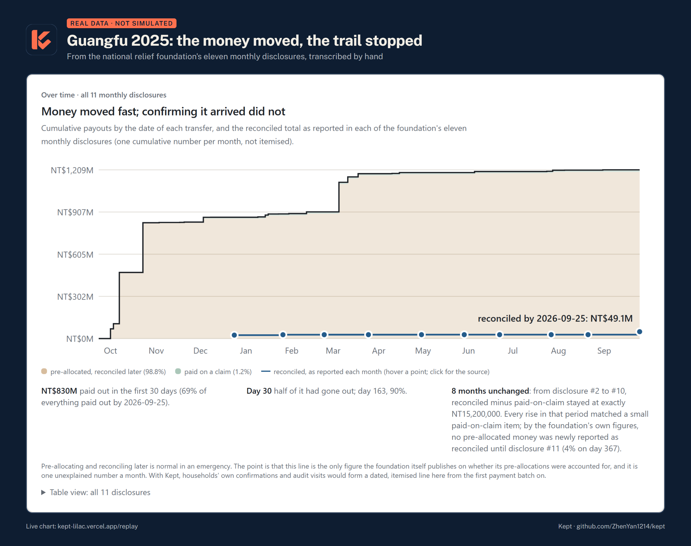
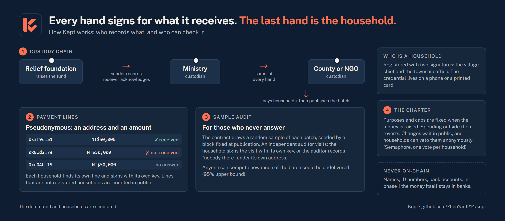
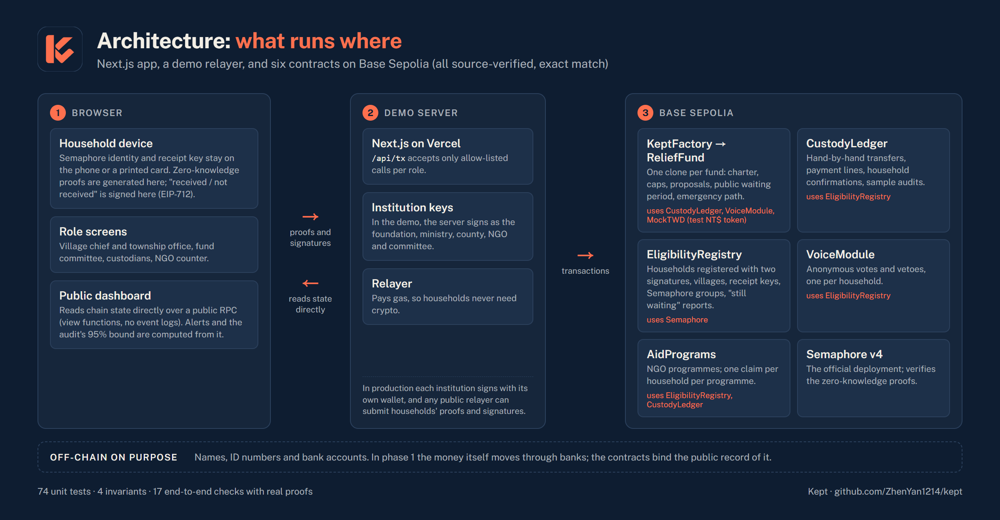
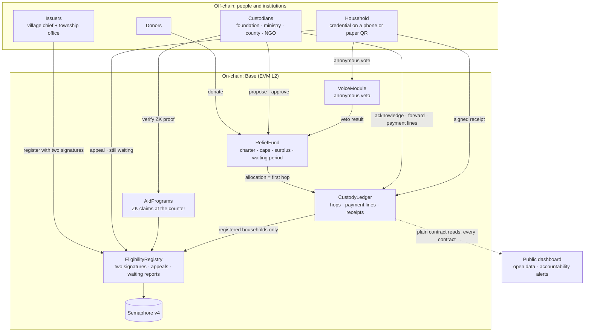
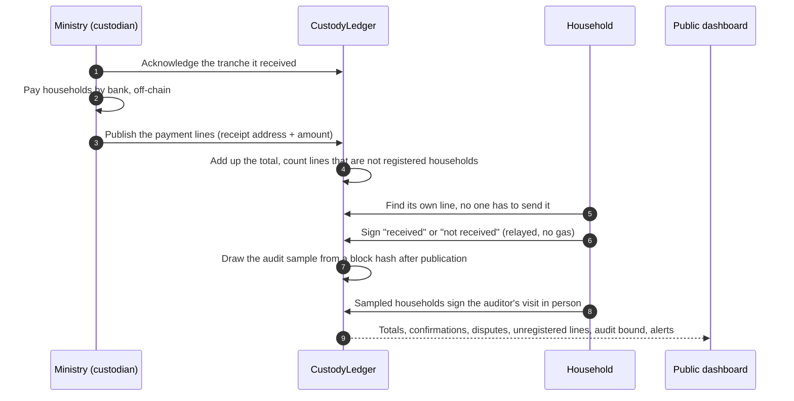

<div align="center">


# Kept

**Disaster-relief promises you can verify.**<br/>
Aid trackers record what custodians say they did. Kept lets the people the money was for confirm or dispute it, on the record.

[](https://kept-lilac.vercel.app)
[](contracts/deployments/84532.json)
[](https://semaphore.pse.dev)
[](#run-it-locally)
[](#license)

[Problem](#the-problem) · [Solution](#the-solution) · [How it works](#how-it-works) · [Architecture](#architecture) · [Why Web3](#why-web3) · [Feasibility](#feasibility) · [Run it](#run-it-locally) · [Limitations](#known-limitations)

<sub>Built for the <i>Web3 for Social Good Hackathon 2026</i> (SMU · GSR Foundation · University of Málaga) · Tech Track</sub>

</div>

---

### What the public record shows

- **Guangfu flood, Taiwan, 2025.** The national relief foundation paid out NT$1.21bn; **98.8% went out as pre-allocations**, to be accounted for later. In its own monthly reports, **for eight months (Dec 2025 – Aug 2026) no pre-allocated money was newly reported as reconciled**. After the first hand the public sees only totals, and households have no public, recorded way to say whether their payment arrived.
- **Hualien earthquake, 2024.** The county received NT$792M in donations; eleven months later it had paid out 16%. Replayed on the county's own records, Kept's *"held over 90 days"* alert would have fired **199 days before the first news story we found on the unspent balance**.

**What Kept does.** Each custodian acknowledges what it receives; households confirm or dispute their own pseudonymous payment line; a random sample drawn on-chain is visited in person by an independent auditor. Getting paid needs nothing from a household, and no names, IDs or bank accounts go on-chain.

**Why on-chain:** the custodians being checked should not keep the only ledger. **Who runs it:** custodians record as they pay; phase 0 needs no one's permission, since volunteers can already turn published disclosures into open data, as the real-data page does.

**→ [Real data](https://kept-lilac.vercel.app/replay) · [Live demo](https://kept-lilac.vercel.app) · [Video (5:54)](https://youtu.be/RRqUkdwZ5Lw) · [Why Kept](https://kept-lilac.vercel.app/why) · [Draft county ordinance](docs/policy/ordinance-summary-en.md)**

**Try it in 2 minutes, no wallet:** (1) read-only, the same for everyone: the [real-data page](https://kept-lilac.vercel.app/replay). (2) Interactive, screens under *Try a role*: *Household* → Create credential → Simulate: chief scans this code; *Village & township* → Propose registration, act as the township office, Approve; *Custodians* → tick your household → Publish payment lines; *Household* → I did not receive it; then *Show code at the counter* and verify it on the *NGO counter* (a second try is rejected). The demo is shared, so others' data may be there; your credential stays in your browser. Fund changes wait a real 5-minute public period.

> [!NOTE]
> The demo fund, households and decisions are **simulated**. The [Guangfu, real data](https://kept-lilac.vercel.app/replay) page is not: it replays the relief foundation's published disclosure. Place names follow Guangfu Township, Hualien (Taiwan), where a barrier lake overflowed on 2025-09-23.

## The problem




A disaster fund makes two promises: **to donors**, about how the money will be used; **to affected households**, that no one will be left out. Both are hard to check, and the same loop repeats across countries: money is raised before a plan exists, the custodian keeps every record, the people affected have no say, money sits unspent or arrives late, and trust moves elsewhere.

| Where | What happened | Source |
|---|---|---|
| **Haiti, 2010** | US$488M raised; six permanent homes built. | [ProPublica/NPR](https://www.propublica.org/article/how-the-red-cross-raised-half-a-billion-dollars-for-haiti-and-built-6-homes) |
| **Valencia, 2024** | The regional audit office found the recording of DANA flood donations *"inadecuado"*; most of the €22.1M received was allocated only in late 2025, a year after the floods. | [El Español](https://www.elespanol.com/valencia/20260106/sindicatura-cuentas-ve-inadecuado-registro-donaciones-dana-millones-no-gestionaron/1003744078508_0.html) |
| **Hualien, 2024** | The county received NT$792M in donations for the earthquake; eleven months later it had earmarked NT$425M and **actually paid out NT$124M (16%)**. Its committee had no affected households on it. Most donors gave to the national relief foundation instead (NT$1.65bn, about twice the county's), which the press attributed to disputes over the county's 2018 donations. | [County report](https://sa.hl.gov.tw/Upload/202504020943277687541.pdf), [PTS](https://news.pts.org.tw/article/744652), [LTN](https://news.ltn.com.tw/news/Hualien/breakingnews/4996579) |
| **Guangfu, 2025** | Of NT$1.21bn paid out by the relief foundation, **98.8% was pre-allocated** and **4% was reconciled** a year later. Across the foundation's monthly disclosures, reconciled minus paid-on-claim stayed at exactly NT$15.2M from Dec 2025 to Aug 2026: **for eight months, no pre-allocated money was newly reported as reconciled**. After the first hand the public sees aggregate totals only, and **households have no public, recorded way to confirm or dispute their own payment**. | [Foundation disclosures](https://www.tf4dr.org/fundraising_plans/156/credits) |
| **Guangfu, 2025** | Residents of three villages outside the "red zone" protested at being left off the county's first consolation list. | [CNA](https://www.cna.com.tw/news/aloc/202510060164.aspx) |

Every group involved has said so in public: an affected household that found out *"only after a year"* that nearly NT$400M was still left; an NGO whose roster was *"finally confirmed at the end of November"*, ten weeks after the flood; an indigenous representative who got *"no meeting notice or call"* for seven months. The sources are on the app's [Why Kept](https://kept-lilac.vercel.app/why) page.

## The solution

Kept starts where the public trail stops: **after the first hand**. Each custodian acknowledges what it receives and publishes every payment batch as pseudonymous lines, a receipt address and an amount and never a name. Each household finds its own line without asking anyone and signs *"received"* or *"not received"*. The custodian gets reconciliation evidence as it happens; the public sees past the first hand; households can say *"this never reached me"*.

| | Today | With Kept |
|---|---|---|
| Visible past the first hand | Aggregate totals | **Every hand, down to pseudonymous payment lines** |
| Household can confirm or dispute its payment | No public, recorded channel (petitions only) | **Signed "received" / "not received"** |
| Custodian can pad the roster or confirm for itself | Not visible to the public | **Lines that are not registered households are counted publicly; only the household, or a social worker designated for its village, can sign** |
| Households who never answer; ghosts registered by colluding officials | Not visible to the public | **Random sample drawn on-chain, visited in person by an independent auditor** |
| Excluded households | Visible through protest | **Public appeals and anonymous "still waiting" counts per village** |
| Say over how the money is used | Up to five may attend; no vote | **Anonymous veto, one vote per household** |
| Fund purposes and surplus | Can be decided later | **Fixed at fundraising; changes wait in public** |
| NGO needs the roster to check eligibility | Yes | **No: a zero-knowledge proof at the counter** |

## How it works




- **Custody.** Each tranche is recorded by the sender and acknowledged by the receiver. Payment batches are published as lines; the contract adds them up itself and counts any line whose receipt address is not a household registered with two signatures. Only that household, or a social worker designated for its village, can sign for its line, and the household's own answer always wins. `CustodyLedger`
- **Eligibility.** A household is verified only after two signatures: the village chief and the township office. Registration rides on the door-to-door visits the government already makes after a disaster. Getting paid never requires anything from the household; confirming is optional. NGOs check eligibility on the spot with a zero-knowledge proof and never receive the roster. `EligibilityRegistry` `AidPrograms`
- **Voice.** The same credential gives each household one anonymous vote on changes (Semaphore), a public appeal when it is left out, and a weekly anonymous *"still waiting"* report that does not depend on any custodian recording anything. `VoiceModule`
- **Commitment.** Purposes, caps and the surplus purpose are fixed when money is raised. Cap changes, extensions and uses of the surplus wait through a public period and go ahead unless households veto them; after a veto the same kind of change is blocked for four waiting periods. Emergencies may only move cap between purposes and are reviewed afterwards. `ReliefFund` `KeptFactory`
- **Sample audit.** Many households will never answer, and a village chief and township office who collude could register households that do not exist and confirm their lines themselves. So for each payment batch the contract draws a random sample of lines (a fifth, at least 5, at most 59), seeded by a block hash just after the batch was published (anyone can trigger the draw; a draw made more than 256 blocks later uses a later block, recorded publicly). An independent auditor visits those households: each signs the visit with its own key, or the auditor records under its own address that nobody lives there. From the visits anyone can compute an upper bound on how much of the batch could be undelivered (95% confidence). `CustodyLedger`
- **Accountability alerts.** Published rules over the public record flag where to look: unacknowledged tranches, money held for months, unregistered lines, disputes, slow appeals, households waiting while the township reports nothing.

**Never on-chain:** names, ID numbers, bank accounts. Payment rosters appear only as pseudonymous lines; a household's confirmation would reveal the same line anyway. Eligibility is still decided by people; Kept makes their decisions attributable.

> [!IMPORTANT]
> In phase 1, while donations stay in bank accounts, the contracts bind the **public record**, not the bank account: nothing outside the charter can be recorded as an allocation, and the record cannot be rewritten, but an off-record bank payment is still possible. Kept makes it harder to hide, not impossible.

## Architecture








Every fund is a clone of one template, and the ledger, the vote module and the dashboard recognise only funds created from it, so a look-alike without the commitments is not counted. Households never pay gas: a relayer submits their signatures and proofs. Borrowed, not reinvented: Semaphore v4 (PSE), OpenZeppelin; prior art includes WFP Building Blocks, Spanish Red Cross RedChain and *Not Yet Another Digital ID* (EPFL × ICRC).

## Would anyone notice?

A Monte Carlo simulation at Guangfu's scale (4,039 households, 4,000 runs per case, every assumption stated) compares what each regime would catch. A failure counts as detected only when bad answers rise above what 95% of honest runs produce, since some honest households answer wrongly or cannot be found.

| 1% of households affected (40) | Today: aggregate totals | Kept: households' own answers | Kept + sample audit |
|---|---|---|---|
| Payments withheld at random | Not in the public record | 89%, median day 29 | 89%, day 28 |
| Withheld from households unlikely to answer | Not in the public record | ≈ chance | 28%, day 27 |
| Ghost households registered by colluding officials | Not in the public record | ≈ chance | 28%, day 27 |
| Eligible households left off every roster | Not in the public record | 90%, day 29 | 85%, day 31 |

At 2% the audit detects ghosts in 73% of runs, at 5% in 100%, assuming the auditor visits honestly; it costs 480 visits (12% of households) and cannot see households who are on no roster. Full results, sensitivity and limits: the [Why Kept](https://kept-lilac.vercel.app/why) page; reproduce with `node web/scripts/fraud-sim.mjs`.

### On real records: a backtest

We replayed Kept's published alert rules against Hualien County's own donation-account records (committee minutes, monthly statements, news), assuming the custodian records under Kept as it goes. An alert is a reason to look, not a finding of wrongdoing.

| Real case (Hualien County donation account) | Kept's alert would fire | Public found out | Earlier by |
|---|---|---|---|
| 2024 earthquake: NT$792M received, 16% paid out after 11 months (rule: held over 90 days) | 2 Jul 2024 | 17 Jan 2025, first news story we found on the balance | 199 days |
| 2025 flood: NT$30M donated for children, NT$0 paid 339 days later (rule: earmarked money held over 90 days) | 25 Dec 2025 | no news report of the delay found | — |
| 2024 earthquake: NT$97M of approved loans, nothing drawn because no one applied (rule: approved plan unpaid after 90 days) | 4 Mar 2026 | 16 Jun 2026, minutes online | 104 days |

Rules about households (unconfirmed or disputed payments) cannot be replayed: no household-level data is public. Timelines, assumptions and sources: the [real-data page](https://kept-lilac.vercel.app/replay) and [`docs/research_notes/…/警示回測資料.md`](docs/research_notes/台灣災難捐款真實案例/警示回測資料.md).

## Why Web3

| Requirement | Why a database is not enough |
|---|---|
| The people being overseen should not keep the only ledger | Each custodian keeps its own records and decides what to publish. |
| Several independent custodians share one record | The foundation, ministries, county and NGOs answer to different authorities; none is a natural operator for the others. |
| Households need anonymous standing | In small communities a named "no" carries social cost; zero-knowledge proofs give "a verified household, one vote, not saying which". |
| Rules that act before, not after | Taiwan's donation law was last amended in January 2020, and later bills that would cover government accounts have not passed; Kept can implement the county ordinance a councillor and nearly 300 residents called for in 2024 (we drafted one). |

## Feasibility

0. **No permission needed:** civil-society volunteers can already turn a custodian's published disclosure into open data and alerts, as the [real-data page](https://kept-lilac.vercel.app/replay) does for Guangfu.
1. **Under current law:** money stays in banks; custodians join voluntarily and get a verifiable record that helps them win back donors.
2. **By ordinance or amendment:** government donation accounts are required to use the format. We drafted the ordinance: a [39-article Hualien County draft](docs/policy/花蓮縣災害民間捐款專戶監督自治條例草案.md) ([English summary](docs/policy/ordinance-summary-en.md)), technology-neutral, without fines so the county can adopt it on its own authority, and mapped article by article to Kept. Its main limit, stated in the draft: a county can bind only its own account, not the national relief foundation, which can opt in.
3. **With regulated NT$ stablecoins** (Taiwan's Virtual Asset Service Act passed in June 2026): funds sit in the contract and the charter is enforced on the money itself.

**Cost, measured** with the real zero-knowledge verifier at Guangfu's scale (4,039 households, 48 transfers, one published line, one confirmation and one NGO claim per household, two votes at 25% turnout): about **4.9 billion gas**, roughly **US$150–1,500** at assumed L2 prices, about **0.003%** of the money raised. Open source (MIT) as a digital public good, complementary to civic platforms such as [guangfu.tw](https://guangfu.tw).

## Run it locally

Requirements: Node 20+, [Foundry](https://getfoundry.sh).

```bash
cd contracts && npm install
forge test                 # 74 unit tests + 4 invariants (random call sequences)
anvil                      # in a separate terminal
npm run deploy:local       # Poseidon, Semaphore and Kept on the local chain
npm run e2e                # optional: 17 end-to-end checks with real Semaphore proofs

cd ../web && npm install
npm run dev                # http://localhost:3000, then Setup → Set up scenario
npm run verify:data        # 72 checks: recomputes the disclosure, backtest, cost and simulation figures and checks the docs quote them (Node 22.18+)
```

The dashboard has a 7-step guided demo. Institutional keys are held by the demo server and a relayer pays gas for households; in production each institution signs with its own wallet.

<details>
<summary><b>Run against Base Sepolia · deployed contracts</b></summary>

Create `kept/.env` (gitignored):

```
DEMO_PRIVATE_KEY=0x…        # a key used only for this testnet demo; other demo roles are derived from it
NEXT_PUBLIC_CHAIN_ID=84532
NEXT_PUBLIC_RPC_URL=https://base-sepolia-rpc.publicnode.com
SEMAPHORE_ADDRESS=0x8A1fd199516489B0Fb7153EB5f075cDAC83c693D
DEMO_TIMELOCK_SECONDS=300
```

```bash
cd contracts && npm run deploy:base-sepolia   # writes deployments/84532.json
cd ../web && npm run dev:testnet              # http://localhost:3001
```

Current addresses are in [`contracts/deployments/84532.json`](contracts/deployments/84532.json). All seven contracts are source-verified (exact match) on [Blockscout](https://base-sepolia.blockscout.com/address/0x36e9859d90E06A084AF602282985c7b568e18072?tab=contract) and Sourcify, so transactions and events decode.

</details>

## Known limitations

- **No field validation yet.** The evidence of need comes from public statements, official records and the foundation's real data, not from interviews or a pilot.
- **Phase 1 cannot stop off-record bank payments;** it raises the cost of hiding them.
- **Pseudonymous, not anonymous.** Each payment line shows a receipt address and an amount, and registrations show village and damage tier, so small villages can be partly inferred by anyone reading the chain. The dashboard hides counts under 5; moving the village off-chain is planned.
- **Majority veto can work against a minority,** for example the few households that need temporary housing. Emergencies keep a path for urgent moves (reviewed afterwards); tier-weighted voting is a possible next step.
- **Votes are anonymous but not receipt-free;** [MACI](https://maci.pse.dev) is the planned upgrade. Votes are veto-only and need a turnout quorum.
- **The registry authority is one key in the demo;** in production it should be a multisig of independent bodies, since the ministry is also a custodian.
- **Colluding issuers could still register ghost households;** two signatures and public issuer statistics make it attributable, and the sample audit catches it with a probability that grows with its scale (28% at 1% of households, 100% at 5% in our simulation), not with certainty.
- **The audit sample is seeded by a block hash,** which a block producer could in principle influence; production should use a public randomness beacon (drand) or a VRF. The auditor is trusted to visit honestly; a false "nobody there" is recorded under its own address.
- **Not externally audited.** Invariant tests and Slither results are documented in [`docs/security-review.md`](docs/security-review.md); a professional audit is a precondition for holding real funds.

## License

[MIT](https://opensource.org/license/mit). Research notes, fact-checks and the full design discussion (Traditional Chinese) are in [`docs/`](docs/README.md).
