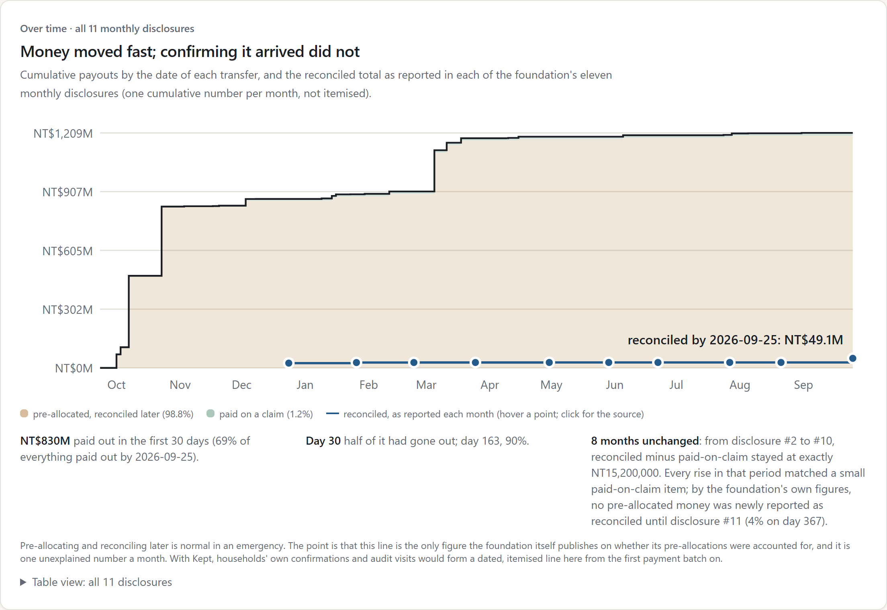
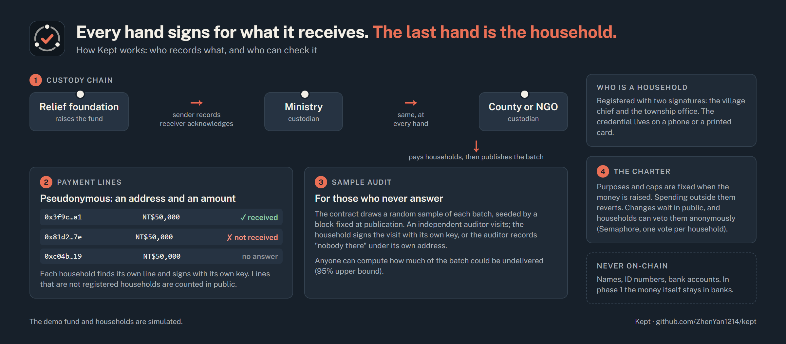

# Kept

Kept lets the households a disaster fund was meant for confirm or dispute, on a public record, the payment each custodian says it made.

## Try it in 2 minutes

- **Real records (read-only):** https://kept-lilac.vercel.app/replay, the relief foundation's 48 Guangfu transfers and 11 monthly disclosures.
- **Demo (no wallet):** https://kept-lilac.vercel.app. Open the screens under *Try a role*:
  - **Household:** create a credential, then let the village chief "scan" it.
  - **Village & township:** propose the registration, then approve it as the township office.
  - **Custodians:** publish payment lines.
  - **Household:** press *I did not receive it*.

  The demo is shared; fund changes wait a real 5-minute period.
- **Video (3:36):** https://youtu.be/kaRP-dOuPSM
- **Code:** https://github.com/ZhenYan1214/kept. `forge test` in `contracts/` runs 74 unit tests and 4 invariants. `npm run verify:data` in `web/` recomputes every real-data figure (70 checks).
- **Proof on Base Sepolia (demo run, 23 Oct 2026; all contracts source-verified, so events decode):**
  - Payment lines published: https://base-sepolia.blockscout.com/tx/0x7c55dfffeb99b27ab479e0cb76fb668717de81035d30194596e8b94b31f1f83f
  - A household answers "not received" with its own key (79,836 gas): https://base-sepolia.blockscout.com/tx/0x7003603d900c67692886c0df9454315ff1828b4c0d1a051999cd138aa3ce04c4
  - An NGO checks eligibility with a zero-knowledge proof: https://base-sepolia.blockscout.com/tx/0x294d749caa547c478fd14b09ef40c3a7f9e5b3770cfe0d4341be178d6c4db273
  - Households veto a cap change: https://base-sepolia.blockscout.com/tx/0xf84035d43a9bc3c741527d6be719405cb2960f699d7c3ebf9d4821df8034449e
  - Custody ledger source: https://base-sepolia.blockscout.com/address/0x36e9859d90E06A084AF602282985c7b568e18072?tab=contract

## The problem

After the September 2025 barrier-lake flood in Guangfu, Taiwan, the national relief foundation paid out NT$1.21bn (≈US$38M) in 48 transfers. To its credit, it publishes every one.

I transcribed all eleven of its monthly disclosures. 98.8% of the money went out as pre-allocations, 93% to one ministry. From December 2025 to August 2026, not one more pre-allocated dollar was reported as reconciled.

After that first hand the public sees only totals. A household has no public, recorded way to say its payment never arrived; it can only petition.

A year earlier, Hualien County received NT$792M for the 2024 earthquake. Eleven months later it had paid out 16%, with no affected households on its committee (county committee report, February 2025; PTS).

## Why it is still unsolved

Pre-allocating in an emergency is normal; the gap is what comes next. Each custodian keeps its own records, so the party being checked holds the pen. Existing tools solve neighbouring problems (RedChain: private eligibility; WFP Building Blocks: deduplication across agencies), but none that I found lets recipients record "it did not arrive".

## Why I built this

I didn't come to this through a disaster of my own. I surveyed where blockchain-for-good projects hold up, and chose disaster donations because Taiwan keeps paying for the same failure. After the 2024 earthquake, a Hualien councillor said that even for a disaster in Hualien, people "would rather give to the central government" (PTS, 2024); disputes over the county's 2018 donations had not been forgotten. So when Guangfu flooded in 2025, I asked whether the money given to the national foundation could be followed to households. The foundation's own records answered: the trail stops after the first hand. That gap is why Kept exists.

My one rule was to start from records anyone can check, not an imagined case. I dropped a volunteer-matching idea because a blockchain added nothing to it.

## How Kept works

Every hand signs for what it receives, and the last hand is the household.

1. Each transfer between custodians (foundation → ministry → county or NGO) is recorded by the sender and acknowledged by the receiver.
2. A household is registered with two signatures, from the village chief and the township office. No name, ID or bank account goes on-chain.
3. A custodian publishes each payment batch as pseudonymous lines (a receipt address and an amount). The contract counts publicly any line that is not a registered household.
4. Each household finds its own line and signs "received" or "not received". Getting paid never depends on answering.
5. For those who never answer, the contract draws a random sample of each batch; an independent auditor visits, and each household signs the visit with its own key.
6. Purposes and caps are fixed in a charter. Changes wait in public, and households can veto them anonymously.

## Why on-chain

- **No single custodian controls the record.** Four kinds of custodian share one append-only chain; if one of them ran the database, the party being checked would keep the pen.
- **Anyone can recompute.** Alerts and the audit's 95% bound come from public state, not a custodian's report.
- **Households take part anonymously.** Semaphore proofs show "a verified household, one vote, not saying which", and let an NGO check eligibility without seeing the roster.
- **Rules are enforced.** Spending outside the charter reverts instead of being a promise in a document.

Personal data and bank payments stay off-chain. At Guangfu's scale a disaster costs about 4.9 billion gas, roughly US$150–1,500 at assumed L2 prices.

## What the contracts refuse

- Money for a purpose outside the charter, or, after the deadline, for anything but the surplus purpose.
- A confirmation from any key except the household's own receipt key, or a social worker designated for that village. The household's own answer always replaces the social worker's.
- A second claim on the same programme by the same household.

## Evidence

- **Contracts:** 74 unit tests; 4 invariants over random call sequences (money conserved, caps respected, custody tree balances, lines add up); an end-to-end script with real Semaphore v4 proofs (17 checks); Slither findings triaged in `docs/security-review.md`.
- **Backtest:** in a backtest that assumes Hualien County had recorded its 2024 donation account under Kept, the "held over 90 days" alert would have fired 199 days before the first news story I found.
- **Simulation:** I modelled officials registering ghost households for 1% of Guangfu's 4,039 households, assuming an honest auditor.
  - Households' own answers catch it only at chance level.
  - The sample audit catches it in 28% of runs, 73% at 2%, and 100% at 5%.

## What I got wrong

- **A misread balance:** I first wrote that NT$420M of Hualien's 2024 donations was unspent a year later; it was the shared account's balance across several disasters. The county's report gives NT$124M paid of NT$792M. I corrected every page.
- **Trusting household answers alone:** I expected households' own answers to expose fraud. But colluding officials can confirm the ghost households they registered, and my simulation put detection at chance level. That is why the in-person audit exists.
- **A dashboard that could not load:** on deployment, the public Base Sepolia RPC limited log queries to 200 blocks. I added view functions so the app reads state without logs.

## Limitations

- **What is simulated:** the demo fund, households and decisions; institution keys sit on the demo server. Only the real-data page is real.
- **No outside input yet:** no practitioner interviews or tests with older users.
- **Phase 1 keeps money in banks**, so off-record payments are harder to hide, not impossible.
- **Security:** the audit seed is a block hash (production should use drand), the contracts are unaudited, and the registry is a single key in the demo.

## What's next

- **During refinement (5–25 Nov):** ask mentors to connect me with a relief custodian and a social worker.
- **Adoption:** the likeliest first custodian is the national relief foundation, which already publishes every transfer. To make county accounts join, I drafted a 39-article Hualien ordinance mapped to Kept: https://github.com/ZhenYan1214/kept/blob/main/docs/policy/ordinance-summary-en.md
- **If Kept wins the incubation grant:** a professional security audit (the precondition for holding real funds) and a Traditional Chinese household interface tested with older users.
- **Deliberately not doing:** a token, real funds before a professional audit, or automatic verdicts. An alert is a reason to look, not a finding.

## About me

I'm a first-year master's student in Taiwan, interested in blockchain, and I built Kept alone for this hackathon. Next, I want to offer the part that needs no one's permission, open data and alerts from the foundation's own disclosures, to the relief foundation and to guangfu.tw.
